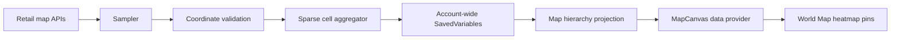

# Heatmap concept

Explorer's Footprint turns movement into a density visualization. It samples the player's normalized map position, assigns the sample to a cell in a fixed grid, and increments that cell's count.

It does not store a route. Two visits to the same cell increase its density; the original timestamps and exact path are not retained.

## Data flow

## Intensity

The first recorded visit is treated as 0% intensity and the most visited cell on the selected map as 100%. Positive cells interpolate through a purple → blue → green → yellow → red gradient. Unrecorded cells have no heatmap pin. Alpha is capped using centralized configuration.

## Hierarchical maps

Source data is kept at its original map level. Parent-continent and child-zone overlays are derived when the map is displayed; they are not saved as separate datasets. A source cell is converted through Retail world coordinates and accumulated into the target map's display grid.

## Boundaries

The Retail API can return no map or no position, especially in restricted content. The sampler skips those intervals. The addon does not attempt to infer positions from another API or force a map transition.
