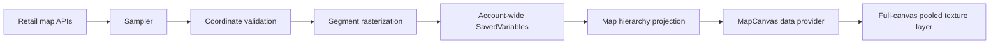

# Heatmap concept

Explorer's Footprint turns movement into a density visualization. It samples the player's normalized map position once per second, assigns positions to cells in a persisted 256 × 256 grid, and rasterizes the segment between consecutive same-map positions. Each crossed cell receives one count for that segment.

It does not store a route. Repeatedly crossing the same cell increases its density, while stationary samples do not add counts. The original timestamps and exact path are not retained.

## Data flow

## Intensity

Intensity uses an absolute logarithmic sample-count scale rather than the most visited cell on the selected map. Counts of 1, 4, 16, 64, and 256 align with the dark purple, blue, teal, green, and bright yellow anchors of the default viridis-style ramp. Counts above 256 remain at the bright end of the scale; unrecorded cells have no heatmap texture run. The minimum heatmap alpha is 0.45 before the user's global opacity multiplier, keeping first-visit cells visible. The former rainbow ramp remains available as a configuration preset.

## Hierarchical maps

Source data is kept at its original map level. Parent-continent and child-zone overlays are derived when the map is displayed; they are not saved as separate datasets. A source cell is converted through Retail world coordinates and accumulated into the target map's 256 × 256 display grid, then render-only downsampling uses 64 × 64 for micro maps and 128 × 128 for zones or dungeons. The renderer stores runtime display cells as numeric counts, quantizes them to a 32-step color lookup table, and merges adjacent same-color cells into pooled texture runs on one full-canvas layer.

Segments whose horizontal or vertical cell distance exceeds 40 are treated as teleports or loading-screen jumps; only the endpoint is recorded. Counts created by this crossing-based model are not directly comparable with older time-sampled counts.

## Boundaries

The Retail API can return no map or no position, especially in restricted content. The sampler skips those intervals. The addon does not attempt to infer positions from another API or force a map transition.
