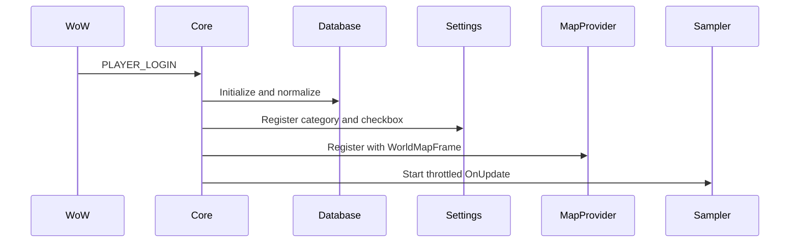

# Architecture

## Components

| Component | Responsibility |
| --- | --- |
| `Core.lua` | Waits for `PLAYER_LOGIN` and starts the addon modules. |
| `Config.lua` | Central defaults for sampling, grid, rendering, and persistence limits. |
| `Localization.lua` | English strings with a locale lookup ready for additional locale files. |
| `Database.lua` | Initializes, validates, migrates, resets, and summarizes `ExplorerFootprintDB`. |
| `Sampler.lua` | Throttles map-position reads and filters stationary samples. |
| `Aggregator.lua` | Converts normalized coordinates to sparse grid-cell counts. |
| `MapProjection.lua` | Relates source and target map IDs, converts positions through world coordinates, and builds temporary target-map cells. |
| `MapProvider.lua` | Registers a `MapCanvasDataProviderMixin` provider and creates map pins. |
| `HeatmapRenderer.lua` | Defines the heatmap pin mixin and visual refresh facade. |
| `Options.lua` | Registers the Retail Settings checkbox. |
| `Debug.lua` | Registers slash commands and the confirmed reset dialog. |

## Initialization flow

## Important boundaries

- The sampler owns runtime reads from `C_Map`; it does not render.
- The aggregator owns coordinate-to-cell conversion; it does not know about frames.
- The projection module derives parent/child display cells without duplicating persisted data.
- The provider owns map pins; it reads persisted counts but does not write raw samples.
- Settings writes only the settings table and asks the provider to refresh.
- The database stores durable data; render state remains transient.

## Extension points

- Add locale tables without changing module behavior.
- Add settings through `Options.lua` and `Config.lua`.
- Add a new persisted field only with a database schema migration.
- Add alternate visual scales in `MapProvider.lua` without changing aggregation.
- Adjust hierarchical projection in `MapProjection.lua`; do not persist projected cells.

## Constraints

- The target API is Retail-only and can return `nil` for map positions.
- The provider depends on Blizzard's MapCanvas templates being available before XML loading.
- The current grid dimensions are configuration defaults, not a user-facing migration-safe setting.
- The repository has no automated Retail client test harness.
